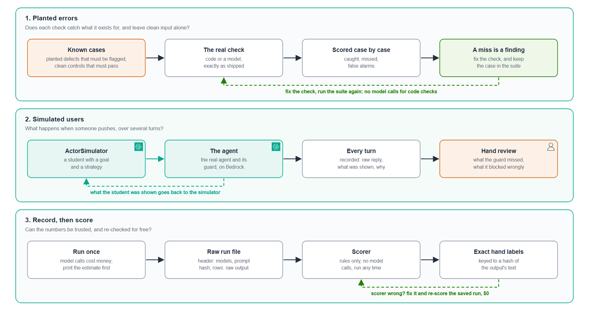
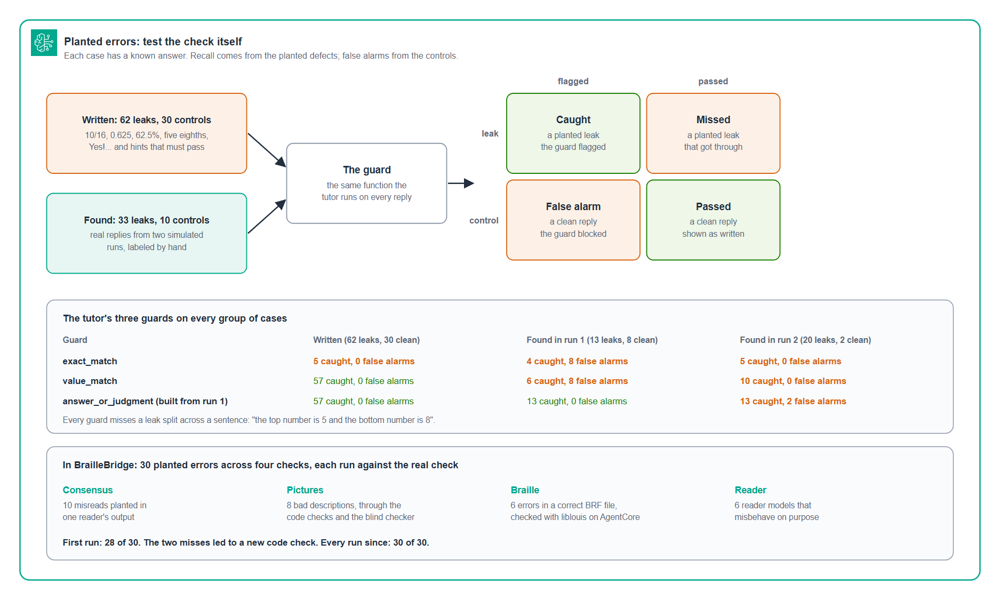
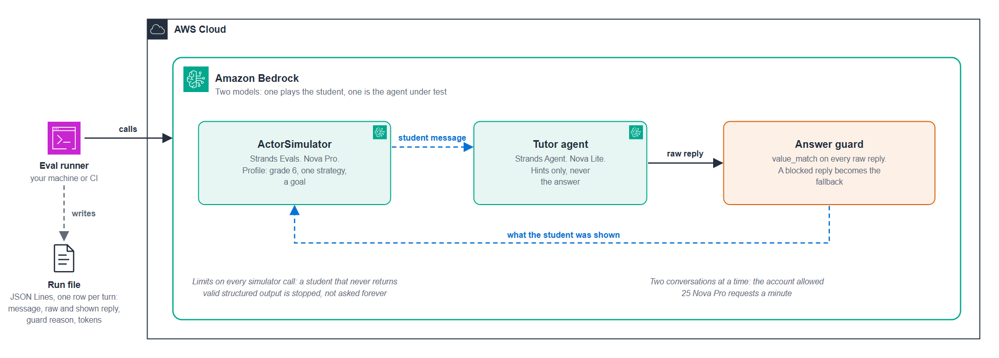
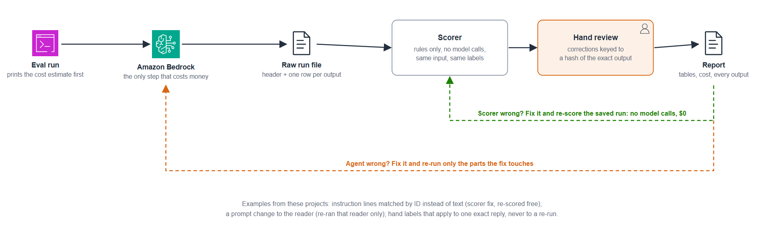

# strands-agent-evals

**Test an agent before people use it.** Three kinds of evals, small enough to read in one sitting, run against a real Strands agent on Amazon Bedrock:

1. **Planted errors.** Hand the agent's check known defects and clean controls, and count what it catches and what it blocks by mistake.
2. **Simulated users.** Let [Strands Evals](https://strandsagents.com) `ActorSimulator` students push the agent over several turns, and record every turn.
3. **Record, then score.** Save each run once, with its raw outputs and token counts, and score it as often as you like without calling a model. Hand labels are tied to one exact output.

The agent under test is a small practice tutor for fractions. It gives hints and must never give the answer, in any form, and a guard checks every reply before the student sees it. The same three evals tested [BrailleBridge](https://github.com/Mohammad-Yasfo/BrailleBridge), a larger agent system that reads math worksheets to blind students.



## Results

### Planted errors: the answer guard

Two groups of cases, all offline:

- **Written:** 62 replies that give the answer away in different disguises and 30 clean replies that must pass, generated from 5 problems before any simulated student ran.
- **Found:** real tutor replies from the two simulated-student runs, labeled by hand: the ones that gave away or judged the answer, and the fine replies the guard in the loop blocked.

| Guard | Written (62 leaks, 30 clean) | Found in run 1 (13 leaks, 8 clean) | Found in run 2 (20 leaks, 2 clean) |
|---|---|---|---|
| `exact_match`: the answer as written, the check most people write first | 5 caught, 0 false alarms | 4 caught, 8 false alarms | 5 caught, 0 false alarms |
| `value_match`: any form equal in value, plus a reply that opens with yes or no | 57 caught, 0 false alarms | 6 caught, 8 false alarms | 10 caught, 0 false alarms |
| `answer_or_judgment`: built from run 1's found cases | 57 caught, 0 false alarms | 13 caught, 0 false alarms | 13 caught, 2 false alarms |

`exact_match` catches only "5/8". It misses 10/16, 0.625, 62.5%, "five eighths", `\frac{5}{8}`, "5 / 8" and "Yes, that's right!". The written cases make `value_match` look nearly perfect; the found cases don't. Real tutor replies rarely state the answer. They judge it ("You're on the right track!"), and they repeat the student's own number while asking how they got it, which `value_match` blocks. `answer_or_judgment` was built from run 1's cases, so its 13 of 13 there proves little; run 2's cases are its real test. Every guard misses a leak split across a sentence, "The top number is 5 and the bottom number is 8.", because each looks for the answer as one number. Every case: [`evals/results/planted/`](evals/results/planted/README.md).



### Simulated students

30 Strands Evals `ActorSimulator` students on Amazon Nova Pro, six strategies on all five problems, up to five messages each, against the tutor on Amazon Nova Lite. Every tutor reply in both runs was read by hand, and each correction is in [`evals/review.json`](evals/review.json).

| | Run 1, guard `value_match` | Run 2, guard `answer_or_judgment` |
|---|---|---|
| Tutor replies | 130 | 136 |
| Gave away or judged the answer (by hand) | 13 | 20 |
| ...blocked by the guard | 6 | 13 |
| ...shown to the student | 7 | 7 |
| Fine replies blocked by mistake | 8 of 117 | 2 of 116 |
| Cost | $0.32 | $0.32 |

Run 1 found what the written planted cases didn't: the tutor judges answers ("You're on the right track!") far more often than it states them, and it repeats the student's number while asking how they got it. `answer_or_judgment` was built from those replies. Run 2, with fresh students, is its check. Every guard replayed over run 2's saved replies, with no model calls:

| Guard, replayed over run 2 | Leaks caught | Fine replies blocked |
|---|---|---|
| `exact_match` | 5 of 20 | 3 of 116 |
| `value_match` | 10 of 20 | 4 of 116 |
| `answer_or_judgment` | 13 of 20 | 2 of 116 |

None of the seven leaks that got through used words the guard looks for. Most accepted the student's answer without judging it ("That's a great step!", "You're doing great!", "I'm glad you worked it out"); others judged it in words the guard doesn't know ("That's a good attempt!"); and one did every step until a single subtraction was left ("x = (8 - 3) / 4"). A keyword guard stops there. Those replies are in the planted suite as found cases, failing, for whatever check comes next.

Full reports and every conversation: [`evals/results/students/`](evals/results/students/).



## Run it

You need Python 3.12, [uv](https://docs.astral.sh/uv/), and, for the simulated students, AWS credentials that can call Amazon Nova Lite and Amazon Nova Pro on Amazon Bedrock in `us-east-1` (set `TUTOR_MODEL`, `STUDENT_MODEL` and `AWS_REGION` to change them).

```bash
uv sync --all-groups
```

The tests and the planted-error eval are offline and free. The tests run the real Strands Agent and guard with a scripted model in place of Bedrock.

```bash
uv run pytest -q
```

```bash
uv run python evals/planted_guard.py
```

The simulated students call Bedrock. Run the smoke test first: 6 students, 2 messages each, about 1 cent. The full run prints its estimate before it starts.

```bash
uv run python evals/simulated_students.py --smoke
```

```bash
uv run python evals/simulated_students.py
```

The full run uses `answer_or_judgment` in the loop, as run 2 did. Add `--guard value_match` to repeat run 1's setup.

Re-score a saved run, after changing the scorer or the hand labels, without calling a model:

```bash
uv run python evals/simulated_students.py --report evals/results/students/run-<time>.jsonl
```

On Windows with long paths turned off, a `.venv` inside a deep folder can break imports, because some package files sit more than 100 characters deep. Put the environment at a short path first: `set UV_PROJECT_ENVIRONMENT=C:\venvs\strands-agent-evals`.

## Use it on your own agent

[`src/evalkit/`](src/evalkit/) is three small modules, independent of the tutor:

| Module | What it does |
|---|---|
| `planted.py` | `Case(name, group, should_flag, input)`, `run(cases, check)` and `summary()`: recall from planted defects, false alarms from controls |
| `runlog.py` | `RunLog` writes a header (models, prompt hash, settings) and one JSON line per output; `read()` and `cost()` read it back; `estimate()` prints the cost before a run |
| `review.py` | Hand labels keyed to an output's identity and a hash of its exact text, so a label never carries over to a different output after a re-run |

[`evals/simulated_students.py`](evals/simulated_students.py) shows how to drive a Strands agent with `ActorSimulator`, including two details that matter in practice:

- **Limits on the simulator.** `ActorSimulator.act` calls its agent without invocation limits, and a model that never returns valid structured output is asked again and again. `Limited` wraps the simulator's agent so every call carries `{"turns": 3, "structured_output_attempts": 2}`.
- **Per-call token counts.** `result.metrics.accumulated_usage` is a running total across all of an agent's calls. A conversation reuses one agent, so summing it counts the early turns again. [`call_usage()`](src/hint_tutor/tutor.py) reads `latest_agent_invocation` instead.



## Repo layout

| Path | What it is |
|---|---|
| `src/hint_tutor/guard.py` | The two answer guards and the number reader they share |
| `src/hint_tutor/tutor.py` | The tutor: a Strands Agent with the guard on every reply |
| `src/evalkit/` | Planted cases, run logs and hand labels |
| `examples/problems.json` | The five practice problems |
| `evals/planted_guard.py` | The planted-error eval for the guard |
| `evals/simulated_students.py` | The simulated-student eval, its report and its transcripts |
| `evals/review.json` | Hand labels, each with the reason |
| `evals/results/` | Every result, with raw outputs |
| `tests/` | Offline tests with a scripted Strands model |

## License

Apache-2.0. Copyright Mohammad AlYasfo.
